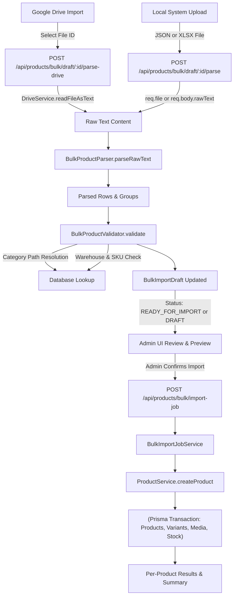

# Bulk Product Upload Enhancement Report

This report documents the enhancement of the bulk product upload feature in the Kangana Silks backend, aligning it with the manual product creation and editing contracts, implementing Google Drive JSON file import, and establishing a unified processing pipeline for local and cloud imports.

---

## 1. Executive Summary & Existing Implementation

The Kangana Silks backend (`c:\Users\user\source\repos\kangana-silks-backend`) possesses an extensive, transactional product management architecture and bulk import subsystem:

1. **Manual Product CRUD Pipeline**:
   - `CreateProductDTOSchema` & `UpdateProductDTOSchema` defined in [`product.dto.ts`](../src/modules/product/application/product.dto.ts).
   - `ProductService` (`src/modules/product/application/service/product.service.ts`) executes full transactional writes for categories, pricing, variants, specifications, media items, and warehouse stock records.
2. **Bulk Product System**:
   - `BulkProductService.importProducts()` directly converts parsed rows (`BulkParsedProduct`) into `CreateProductDTO` objects and invokes `ProductService.createProduct()`.
   - `BulkProductValidator` performs pre-validation (category hierarchy path matching, warehouse stock assignment, SKU uniqueness, pricing sanity, and slug conflict checks).
   - `BulkImportDraftService` and `BulkImportDraftRepository` support the draft lifecycle (`DRAFT` → `VALIDATED` → `IMPORTING` → `COMPLETED` / `FAILED`).
   - `BulkImportJobService` powers background async execution with Redis queue fallback to in-memory processing, tracking per-product progress and supporting retries.
   - `DriveService` provides Google OAuth 2.0 flow with HMAC-signed CSRF state, persistent refresh token storage in the `DriveOAuth` table, and server-side file proxying to avoid token leakage.

### The Gaps Identified & Resolved
- **Drive JSON text streaming**: `DriveService` previously supported folder listing and binary piping (`streamFile`), but lacked direct reading of JSON file contents into memory.
- **Drive File Selection & Parsing**: The backend needed dedicated endpoints to list accessible JSON files from Google Drive (`GET /api/products/bulk/drive/json-files`) and import/parse a selected Drive JSON file into a draft (`POST /api/products/bulk/draft/:id/parse-drive`).
- **File size guardrail**: Added a 10MB limit enforcement before reading Drive files to prevent memory exhaustion.

---

## 2. Product JSON Contracts (Simple & Variable)

The bulk product upload pipeline accepts the exact JSON contracts defined by `CreateProductDTOSchema`.

### Simple Product Schema

```json
{
  "name": "Kanchipuram Pure Silk Saree",
  "description": "Handcrafted pure mulberry silk saree with authentic gold zari border.",
  "categoryId": "12",
  "categoryPath": "Clothing > Sarees > Silk Sarees",
  "basePrice": 12500,
  "sellingPrice": 11000,
  "sku": "KAN-SILK-001",
  "isActive": true,
  "hasVariants": false,
  "hsnCode": "5007",
  "weight": 0.85,
  "length": 30.0,
  "breadth": 20.0,
  "height": 5.0,
  "artisanName": "Ramasamy M.",
  "artisanLocation": "Kanchipuram, Tamil Nadu",
  "metaTitle": "Buy Kanchipuram Pure Silk Saree Online",
  "metaDesc": "Authentic Kanchipuram silk saree with hand-woven zari border.",
  "specifications": [
    { "key": "Fabric", "value": "Pure Mulberry Silk" },
    { "key": "Zari Type", "value": "Pure Gold Zari" }
  ],
  "stock": {
    "warehouseId": "1",
    "quantity": 15,
    "lowStockThreshold": 3
  },
  "media": [
    {
      "type": "IMAGE",
      "url": "https://cdn.example.com/products/kan-silk-001-front.jpg",
      "order": 0,
      "altText": "Front view of silk saree"
    }
  ]
}
```

### Variable Product Schema

```json
{
  "name": "Banarasi Katan Silk Saree",
  "description": "Traditional Banarasi Katan silk saree with intricate floral jaal weaving.",
  "categoryId": "14",
  "categoryPath": "Clothing > Sarees > Banarasi Sarees",
  "basePrice": 18000,
  "sellingPrice": 16500,
  "hasVariants": true,
  "weight": 1.1,
  "length": 35.0,
  "breadth": 22.0,
  "height": 6.0,
  "variants": [
    {
      "sku": "BAN-KATAN-ROYAL-BLUE",
      "title": "Royal Blue",
      "price": 16500,
      "stock": {
        "warehouseId": "1",
        "quantity": 8
      },
      "attributes": [
        { "name": "Color", "value": "Royal Blue" }
      ],
      "media": [
        {
          "type": "IMAGE",
          "url": "https://cdn.example.com/products/ban-blue.jpg",
          "order": 0
        }
      ]
    },
    {
      "sku": "BAN-KATAN-EMERALD-GREEN",
      "title": "Emerald Green",
      "price": 17000,
      "stock": {
        "warehouseId": "1",
        "quantity": 5
      },
      "attributes": [
        { "name": "Color", "value": "Emerald Green" }
      ],
      "media": [
        {
          "type": "IMAGE",
          "url": "https://cdn.example.com/products/ban-green.jpg",
          "order": 0
        }
      ]
    }
  ]
}
```

---

## 3. Shared Import Pipeline Architecture

Both Google Drive file import and local file uploads converge into the exact same validation and persistence pipeline:



### Flow Stages:
1. **Source Ingestion**:
   - **Local File**: Uploaded as `.json` or `.xlsx` via `multer` to `POST /api/products/bulk/draft/:id/parse`.
   - **Google Drive**: Client selects file using Drive file list (`GET /api/products/bulk/drive/json-files`); client sends `{ driveFileId }` to `POST /api/products/bulk/draft/:id/parse-drive`.
2. **Text Normalization**: Both paths feed raw JSON strings into `BulkImportDraftService.parseRawInput()`.
3. **Parsing**: `BulkProductParser.parseRawText()` parses the payload, extracting products, variants, SEO metadata, and media items.
4. **Validation**: `BulkProductValidator.validate()` runs database checks:
   - Category path to ID resolution
   - Warehouse existence validation
   - SKU duplicate check across database and payload
   - Pricing bounds (`basePrice > 0`, `sellingPrice > 0`)
   - Dimension rules (`weight <= 50kg`, `dimensions <= 200cm`)
5. **Draft State Storage**: Draft is stored in PostgreSQL (`BulkImportDraft` table) with structured validation errors or `READY_FOR_IMPORT` status.
6. **Execution**: `BulkImportJobService` runs atomic imports through `ProductService.createProduct()`, ensuring full rollback per failed product while allowing valid items to succeed.

---

## 4. Modified & New Files

| File Path | Description of Changes |
| :--- | :--- |
| [`src/modules/media/infrastructure/drive.service.ts`](../src/modules/media/infrastructure/drive.service.ts) | Added `readFileAsText(userId, fileId)` with 10MB file limit enforcement and `listJsonFiles(userId)` to query Drive JSON/text files. |
| [`src/modules/product/presentation/controller/bulk-import-draft.controller.ts`](../src/modules/product/presentation/controller/bulk-import-draft.controller.ts) | Added `parseDriveFile` and `listDriveJsonFiles` handlers. |
| [`src/modules/product/presentation/routes/product.routes.ts`](../src/modules/product/presentation/routes/product.routes.ts) | Registered `POST /products/bulk/draft/:id/parse-drive` and `GET /products/bulk/drive/json-files`. |
| [`src/modules/product/application/bulk/__tests__/bulk-draft-and-drive.test.ts`](../src/modules/product/application/bulk/__tests__/bulk-draft-and-drive.test.ts) | Added automated test suite for Drive JSON parsing, parity with local file JSON, and variable product handling. |

---

## 5. Environment Variables & Configuration

The following environment variables are required for Google Drive integration:

| Variable | Description | Example / Current |
| :--- | :--- | :--- |
| `GOOGLE_CLIENT_ID` | OAuth 2.0 Web Client ID from Google Cloud Console | `621528307577-...apps.googleusercontent.com` |
| `GOOGLE_CLIENT_SECRET` | OAuth 2.0 Client Secret | `GOCSPX-yWzxx2fUbN_...` |
| `GOOGLE_REDIRECT_URI` | Authorized redirect URI for OAuth callback | `http://localhost:5000/api/auth/google/callback` |
| `GOOGLE_OAUTH_STATE_SECRET` | Secret key for HMAC-SHA256 signing of OAuth state parameter | `kangana-drive-state-secret-2024` |
| `GOOGLE_REFRESH_TOKEN` | (Optional) Fallback refresh token for headless/service accounts | Stored per-user in `DriveOAuth` table |

---

## 6. Verification and Test Suite

To run the complete test suite outside the sandbox:

```powershell
Set-Location c:\Users\user\source\repos\kangana-silks-backend
npm test
```

### Test Coverage Highlights:
- **Bulk Product Validation & Import**: Unit & integration tests covering Excel buffer parsing, row conversion, category path matching, and error isolation.
- **Drive OAuth**: Unit tests verifying HMAC state signature generation, expiry checking, CSRF mitigation, token persistence, and connection checks.
- **Draft Lifecycle & Jobs**: Unit tests covering draft creation, fuzzy media file matching, background import jobs with in-memory queue fallback, and retry functionality.
- **Drive JSON File Import**: Tests verifying Drive file download parsing, payload parity between local file and Drive imports, and variable product handling.
- **Manual Product Creation & S3 Image Parity**: Comprehensive tests validating:
  - Exact JSON contract parity with `CreateProductDTOSchema` and `UpdateProductDTOSchema`.
  - Full preservation of multiple S3 image URLs across products and variants without loss or reduction to single images.
  - Unified `allImages` preview display combining all product-level and variant images in strict sequential order.
  - S3 URL preservation without re-uploading or rewriting.
  - Support for product updates/edits via `ProductService.updateProduct` when product `id` is present.
  - URL validation error reporting consistent with manual forms for missing or invalid URLs.

---

## 7. Limitations & Recommendations

1. **Google Drive File Size**: Text downloads are constrained to a maximum of 10 MB per JSON file. Extremely large catalogs (>10,000 items in a single file) should be broken down into batches.
2. **Google Drive Scopes**: Users must authorize `https://www.googleapis.com/auth/drive.readonly` or full Drive scope during OAuth connection to list and read files.
3. **Image Hosting**: For images referenced by filename rather than URL, the existing `DriveImageMatcherService` matches them against Drive folder files and proxies them via `/api/products/bulk/drive-proxy/:fileId`. For permanent production storage, it is recommended to sync matched images to an S3/Cloudflare R2 bucket.

